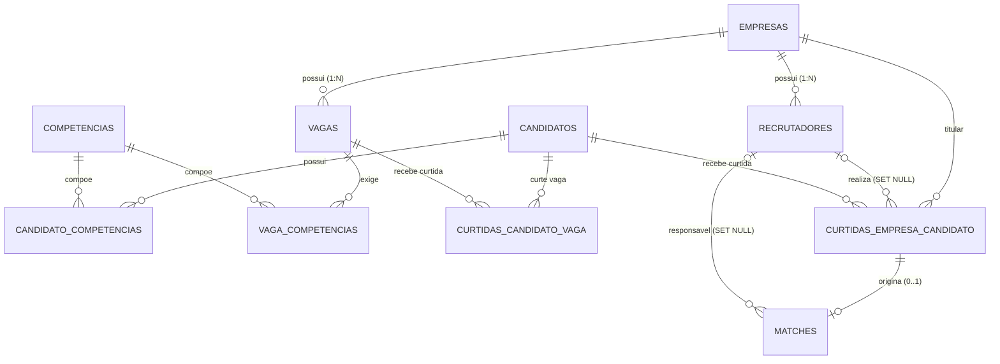

# Especificação Funcional e Técnica — Feature Match (Persistência Relacional e Demonstração SQL)

- **Feature:** `match`
- **Issue vinculada:** [#3 — [FEATURE] Implementar persistência de Curtidas e Matches no PostgreSQL](https://github.com/nelsonlima1989/Linketinder-Project/issues/3)
- **Branch:** `feature/match-bd`
- **Commit base:** `7f17c41` (`Merge pull request #2 from nelsonlima1989/feature/recrutador`)
- **Camada afetada:** Banco de Dados (PostgreSQL), Scripts SQL (`database/database.sql`, `database/queries.sql`), MER (`docs/der-linketinder.png`) e Documentação (`README.md`)
- **Status:** Aprovada tecnicamente (decisões DP-01 a DP-04 revisadas contra contradições de triggers, `SET NULL`, exclusão em cascata e concorrência)

---

## 1. Contexto

O Linketinder é um sistema de contratação inspirado em LinkedIn e Tinder que aproxima **candidatos** e **empresas** por **competências (skills)**, sob o **Princípio do Anonimato** antes do match.

### Estado real verificado no repositório (commit `7f17c41`)

| Item | Estado Atual | Evidência |
|---|---|---|
| Tabela `curtidas_candidato_vaga` | **Implementada**: registra `(candidato_id, vaga_id, data_curtida)` com PK composta e FKs sem `ON DELETE` | [`database/database.sql`](../../database.sql) (linhas 108–123) |
| Tabela `curtidas_empresa_candidato` | **Parcial**: registra `(empresa_id, candidato_id, data_curtida)`, sem identificar o recrutador responsável (`recrutador_id`) e sem `ON DELETE` | [`database/database.sql`](../../database.sql) (linhas 130–145) |
| Tabela `recrutadores` | **Implementada**: relação `Empresa (1) → (N) Recrutadores` com `ON DELETE CASCADE` | [`database/database.sql`](../../database.sql) (linhas 152–171) |
| Tabela `matches` | **Inexistente**: não há tabela para persistir matches; existe apenas uma consulta `SELECT` derivada em `queries.sql` | [`database/queries.sql`](../../queries.sql) (linhas 494–509) |
| Seeds SQL (`queries.sql`) | **Inconsistentes para a evolução**: a seção `8. CURTIDAS: EMPRESA -> CANDIDATO` é executada **antes** da seção `8.1 RECRUTADORES`, e as empresas `4` e `5` possuem curtidas sem recrutadores cadastrados nos seeds | [`database/queries.sql`](../../queries.sql) (linhas 312–395) |
| Diagrama MER (`der-linketinder.png`) | **Desatualizado**: reflete apenas 8 tabelas iniciais (sem coluna `estado`, sem tabela `recrutadores`, sem `recrutador_id` nas curtidas da empresa e sem tabela `matches`) | [`docs/der-linketinder.png`](../der-linketinder.png) |
| Documentação (`README.md`) | **Desatualizada**: marca a persistência de curtidas e matches como *"⏳ Próximo desafio"* | [`README.md`](../../../README.md) (linhas 570–594) |

---

## 2. Objetivos

1. **Persistir curtidas de candidatos em vagas** (`curtidas_candidato_vaga`) garantindo integridade referencial (`ON DELETE CASCADE`) e unicidade por par `(candidato_id, vaga_id)`.
2. **Persistir curtidas de empresas em candidatos** (`curtidas_empresa_candidato`) exigindo no momento da curtida um **recrutador responsável válido pertencente à própria empresa**, e preservando a curtida caso o recrutador seja excluído futuramente (`recrutador_id` passa a `NULL` via `ON DELETE SET NULL`).
3. **Identificar e registrar matches automaticamente via triggers PostgreSQL** na tabela `matches` (sem `vaga_id`, com unicidade por `(empresa_id, candidato_id)`) sempre que houver interesse mútuo, **independentemente da ordem das curtidas**.
4. **Manter a consistência de `matches` em operações de `INSERT`, `UPDATE` e `DELETE`:**
   - Impedir a existência de qualquer match sem reciprocidade ativa;
   - Ao excluir candidato ou empresa, remover curtidas e matches em cascata (`CASCADE`);
   - Ao excluir uma vaga (ou curtida em vaga), desfazer o match **somente quando não restarem outras curtidas válidas** do candidato em vagas daquela empresa;
   - Permitir a **recriação do match** caso um match anterior tenha sido desfeito e uma nova curtida volte a estabelecer a reciprocidade;
   - Ao excluir um recrutador, **preservar** as curtidas da empresa e os matches, atualizando `recrutador_id` para `NULL` (`ON DELETE SET NULL`) sem conflito de ordem de disparo entre triggers.
5. **Migrar de forma segura os dados existentes** em `database/queries.sql` (e documentar a migração incremental para bancos existentes), demonstrar os cenários em SQL, atualizar o **MER** (`docs/der-linketinder.png`) e documentar tudo no `README.md`.

---

## 3. Escopo e Exclusões

### 3.1 Escopo Incluído
- **Esquema e Triggers PostgreSQL (`database/database.sql`):**
  - Atualização de `vagas` e `curtidas_candidato_vaga` com `ON DELETE CASCADE` para suportar a exclusão em cascata de empresa, candidato e vaga.
  - Evolução de `curtidas_empresa_candidato` com coluna `recrutador_id`, `ON DELETE CASCADE` para empresa/candidato, `ON DELETE SET NULL` para recrutador e trigger de validação de pertencimento do recrutador à empresa no momento da curtida.
  - Criação da tabela `matches` (sem `vaga_id`, com `UNIQUE (empresa_id, candidato_id)`).
  - Criação das funções e triggers PostgreSQL para registro automático, proteção contra concorrência/duplicação e remoção condicional de matches quando a reciprocidade deixa de existir.
- **Seeds, Migração e Demonstração SQL (`database/queries.sql`):**
  - Reordenação dos seeds (`recrutadores` antes de `curtidas_empresa_candidato`) e adição de recrutadores para as empresas `4` e `5`.
  - Demonstração em SQL das duas ordens de curtida, não duplicação em múltiplas vagas, manutenção/remoção de match ao excluir vaga, preservação ao excluir recrutador (`SET NULL`), recriação de match e rejeição de violações de integridade.
- **Diagrama MER (`docs/der-linketinder.png`) e Documentação (`README.md`).**

### 3.2 Exclusões de Escopo (Estritas)
- **Código Backend Groovy (`src/main/groovy/**` e `src/test/groovy/**`):** **Não** serão alterados models, repositories, DAOs, services, controllers, `Menu.groovy` nem `Main.groovy`.
- **API HTTP (`src/main/groovy/com/linketinder/api/**`):** **Não** serão criados ou modificados endpoints HTTP.
- **Frontend TypeScript (`frontend/**`):** **Não** serão alterados modelos, serviços, componentes ou telas do frontend.

---

## 4. Requisitos Funcionais

- **RF-01 — Persistir Curtida de Candidato em Vaga:** Persistir em `curtidas_candidato_vaga` o par `(candidato_id, vaga_id)` com `data_curtida`, impedindo duplicidade pela chave primária composta.
- **RF-02 — Persistir Curtida de Empresa em Candidato com Recrutador Responsável:** Persistir em `curtidas_empresa_candidato` o par `(empresa_id, candidato_id)` com `recrutador_id` e `data_curtida`, exigindo na criação que `recrutador_id` seja informado e pertença à `empresa_id`.
- **RF-03 — Registrar Match Automaticamente nas Duas Ordens de Curtida:** Registrar automaticamente via triggers na tabela `matches` o vínculo `(empresa_id, candidato_id, recrutador_id, data_match)` tanto quando o candidato curte a vaga primeiro e o recrutador curte depois, quanto quando o recrutador curte primeiro e o candidato curte a vaga depois.
- **RF-04 — Garantir Unicidade de Match por Empresa/Candidato:** Assegurar no máximo 1 registro em `matches` por par `(empresa_id, candidato_id)`, sem coluna `vaga_id`, mesmo quando o candidato curte múltiplas vagas da mesma empresa.
- **RF-05 — Manter Reciprocidade Estrita na Exclusão de Vagas ou Curtidas:**
  - Se uma curtida da empresa em candidato for removida, o match correspondente deve ser removido imediatamente (`ON DELETE CASCADE`).
  - Se uma vaga (ou curtida de candidato em vaga) for removida, o match `(empresa_id, candidato_id)` deve ser **mantido** caso ainda exista outra vaga da mesma empresa curtida pelo candidato, e **removido** caso não reste nenhuma curtida válida do candidato em vagas daquela empresa.
- **RF-06 — Permitir Recriação de Match:** Se um match for desfeito por perda de reciprocidade (ex.: exclusão da única vaga curtida) e, posteriormente, uma nova curtida restabelecer o interesse mútuo, um novo registro de match deve ser criado automaticamente.
- **RF-07 — Preservar Curtidas e Matches ao Excluir Recrutador:** Ao excluir um registro de `recrutadores`, as curtidas em `curtidas_empresa_candidato` e os matches em `matches` associados àquele recrutador devem ser preservados, tendo `recrutador_id` atualizado para `NULL` (`ON DELETE SET NULL`).
- **RF-08 — Migrar Dados Existentes e Demonstrar por SQL:** Adequar os seeds em `database/queries.sql`, prover script/instruções de migração segura para dados existentes e incluir consultas SQL demonstrando todos os cenários.
- **RF-09 — Atualizar MER e Documentação:** Atualizar `docs/der-linketinder.png` e `README.md`.

---

## 5. Regras de Negócio

- **RN-01 — Atores da Curtida:**
  - O **Candidato** curte **Vagas** (`curtidas_candidato_vaga`).
  - O **Recrutador** curte **Candidatos** em nome da sua **Empresa** (`curtidas_empresa_candidato`).
- **RN-02 — Validação do Recrutador no Momento da Curtida:**
  - No momento da inserção (`INSERT`) em `curtidas_empresa_candidato`, `recrutador_id` é **obrigatório** (`NOT NULL`) e deve pertencer à `empresa_id` informada (`recrutadores.empresa_id = curtidas_empresa_candidato.empresa_id`).
  - Em atualizações (`UPDATE`), os identificadores `(empresa_id, candidato_id)` são imutáveis; `recrutador_id` só pode transitar para `NULL` quando o próprio recrutador tiver sido removido de `recrutadores` (`ON DELETE SET NULL`); caso um novo `recrutador_id` não nulo seja informado, ele deve pertencer à mesma `empresa_id`.
- **RN-03 — Condição de Existência e Invariante de Match:**
  - Um registro em `matches (empresa_id, candidato_id)` existe se, e somente se:
    1. Existir a curtida em `curtidas_empresa_candidato (empresa_id, candidato_id)`; **e**
    2. Existir ao menos uma curtida em `curtidas_candidato_vaga (candidato_id, vaga_id)` cuja vaga pertença àquela empresa (`vagas.empresa_id = empresa_id`).
  - Não pode existir match sem reciprocidade ativa em nenhum estado comitado do banco.
- **RN-04 — Independência da Ordem e Idempotência:**
  - O match é registrado automaticamente quer a curtida do candidato anteceda a do recrutador, quer a curtida do recrutador anteceda a do candidato.
  - Curtidas adicionais do candidato em outras vagas da mesma empresa são permitidas em `curtidas_candidato_vaga`, mas **não duplicam** o match já existente.
- **RN-05 — Política de Exclusão (`ON DELETE`):**
  - **Exclusão de Candidato ou Empresa:** remove em cascata (`ON DELETE CASCADE`) todas as suas vagas, recrutadores, competências associadas, curtidas e matches.
  - **Exclusão de Vaga:** remove em cascata (`ON DELETE CASCADE`) as competências e curtidas daquela vaga; o match `(empresa_id, candidato_id)` só é excluído se não restar nenhuma outra vaga da mesma empresa curtida pelo candidato.
  - **Exclusão de Recrutador:** preserva o histórico de curtidas da empresa e os matches formados, definindo `recrutador_id = NULL` (`ON DELETE SET NULL`) tanto em `curtidas_empresa_candidato` quanto em `matches`.

---

## 6. Modelo de Dados e Automação (PostgreSQL)

### 6.1 Ajustes de `ON DELETE CASCADE` nas Tabelas Relacionadas
Para que a exclusão de candidato, empresa ou vaga propague sem erro de chave estrangeira (cumprindo `DP-03`), as FKs de `vagas`, `candidato_competencias` e `vaga_competencias` devem possuir `ON DELETE CASCADE`, além de `curtidas_candidato_vaga`:

```sql
CREATE TABLE curtidas_candidato_vaga
(
    candidato_id INTEGER     NOT NULL,
    vaga_id      INTEGER     NOT NULL,
    data_curtida TIMESTAMPTZ NOT NULL DEFAULT CURRENT_TIMESTAMP,

    CONSTRAINT pk_curtidas_candidato_vaga
        PRIMARY KEY (candidato_id, vaga_id),

    CONSTRAINT fk_curtida_candidato
        FOREIGN KEY (candidato_id)
            REFERENCES candidatos (id)
            ON DELETE CASCADE,

    CONSTRAINT fk_curtida_vaga
        FOREIGN KEY (vaga_id)
            REFERENCES vagas (id)
            ON DELETE CASCADE
);

CREATE INDEX idx_curtidas_cand_vaga_vaga_id
    ON curtidas_candidato_vaga (vaga_id);
```

### 6.2 Tabela `curtidas_empresa_candidato`
A coluna `recrutador_id` é declarada `INTEGER NULL` com `ON DELETE SET NULL` para suportar a preservação histórica quando um recrutador é excluído (`DP-04`), enquanto o trigger `trg_validar_curtida_empresa_recrutador` garante que `recrutador_id` seja `NOT NULL` e pertença à `empresa_id` no momento do `INSERT`:

```sql
CREATE TABLE curtidas_empresa_candidato
(
    empresa_id    INTEGER     NOT NULL,
    candidato_id  INTEGER     NOT NULL,
    recrutador_id INTEGER     NULL,
    data_curtida  TIMESTAMPTZ NOT NULL DEFAULT CURRENT_TIMESTAMP,

    CONSTRAINT pk_curtidas_empresa_candidato
        PRIMARY KEY (empresa_id, candidato_id),

    CONSTRAINT fk_curtida_empresa
        FOREIGN KEY (empresa_id)
            REFERENCES empresas (id)
            ON DELETE CASCADE,

    CONSTRAINT fk_curtida_candidato_emp
        FOREIGN KEY (candidato_id)
            REFERENCES candidatos (id)
            ON DELETE CASCADE,

    CONSTRAINT fk_curtida_recrutador
        FOREIGN KEY (recrutador_id)
            REFERENCES recrutadores (id)
            ON DELETE SET NULL
);

CREATE INDEX idx_curtidas_emp_cand_candidato_id
    ON curtidas_empresa_candidato (candidato_id);

CREATE INDEX idx_curtidas_emp_cand_recrutador_id
    ON curtidas_empresa_candidato (recrutador_id);
```

### 6.3 Tabela `matches` (Sem `vaga_id`, Unicidade por `empresa_id` e `candidato_id`)
Para evitar caminhos de cascata redundantes e conflitantes durante `DELETE FROM empresas` ou `DELETE FROM candidatos`, `matches` referencia `curtidas_empresa_candidato (empresa_id, candidato_id) ON DELETE CASCADE` (que por sua vez já sofre cascata a partir de `empresas` e `candidatos`) e `recrutadores (id) ON DELETE SET NULL`:

```sql
CREATE TABLE matches
(
    id            SERIAL      PRIMARY KEY,
    empresa_id    INTEGER     NOT NULL,
    candidato_id  INTEGER     NOT NULL,
    recrutador_id INTEGER     NULL,
    data_match    TIMESTAMPTZ NOT NULL DEFAULT CURRENT_TIMESTAMP,

    CONSTRAINT uq_matches_empresa_candidato
        UNIQUE (empresa_id, candidato_id),

    CONSTRAINT fk_matches_curtida_empresa_candidato
        FOREIGN KEY (empresa_id, candidato_id)
            REFERENCES curtidas_empresa_candidato (empresa_id, candidato_id)
            ON DELETE CASCADE,

    CONSTRAINT fk_matches_recrutador
        FOREIGN KEY (recrutador_id)
            REFERENCES recrutadores (id)
            ON DELETE SET NULL
);

CREATE INDEX idx_matches_candidato_id ON matches (candidato_id);
CREATE INDEX idx_matches_recrutador_id ON matches (recrutador_id);
```

### 6.4 Especificação Detalhada dos Triggers (Prevenção de Contradições entre `SET NULL`, Cascata e Concorrência)

1. **`fn_validar_curtida_empresa_recrutador` (`BEFORE INSERT OR UPDATE ON curtidas_empresa_candidato`):**
   - Em `UPDATE`: impede alteração da chave primária (`NEW.empresa_id <> OLD.empresa_id OR NEW.candidato_id <> OLD.candidato_id`).
   - Em `INSERT`: exige `NEW.recrutador_id IS NOT NULL` (dispara `RAISE EXCEPTION` caso seja `NULL`).
   - Em `INSERT` ou `UPDATE` quando `NEW.recrutador_id IS NOT NULL`: verifica se `EXISTS (SELECT 1 FROM recrutadores r WHERE r.id = NEW.recrutador_id AND r.empresa_id = NEW.empresa_id)`. Caso não exista, dispara `RAISE EXCEPTION`.
   - Em `UPDATE` quando `NEW.recrutador_id IS NULL`: permite **somente** se `NOT EXISTS (SELECT 1 FROM recrutadores r WHERE r.id = OLD.recrutador_id)` (ou seja, quando acionado pela ação referencial `ON DELETE SET NULL` na exclusão do recrutador), bloqueando `UPDATE curtidas_empresa_candidato SET recrutador_id = NULL` manual enquanto o recrutador existir.

2. **`fn_validar_match` (`BEFORE INSERT OR UPDATE ON matches`):**
   - **Prevenção de conflito na ordem de disparo de `ON DELETE SET NULL` e `DELETE FROM empresas`:**
     - Em `INSERT`:
       - Adquire `PERFORM pg_advisory_xact_lock(NEW.empresa_id, NEW.candidato_id)`.
       - Verifica que existe `curtidas_empresa_candidato` para `(NEW.empresa_id, NEW.candidato_id)`.
       - Verifica que existe ao menos uma linha em `curtidas_candidato_vaga ccv INNER JOIN vagas v ON v.id = ccv.vaga_id` para `(NEW.candidato_id, NEW.empresa_id)`.
       - Se `NEW.recrutador_id IS NOT NULL`, verifica que pertence a `NEW.empresa_id`.
     - Em `UPDATE`:
       - Impede alteração de `empresa_id` ou `candidato_id`.
       - Se `NEW.recrutador_id IS NULL`: verifica apenas `NOT EXISTS (SELECT 1 FROM recrutadores r WHERE r.id = OLD.recrutador_id)`. **Não** revalida `curtidas_candidato_vaga` nem compara `NEW.recrutador_id` com `curtidas_empresa_candidato.recrutador_id` durante o `UPDATE`, pois durante `DELETE FROM recrutadores` (ou `DELETE FROM empresas`) a trigger RI de `matches` pode disparar antes da trigger RI de `curtidas_empresa_candidato` ou após a exclusão em cascata de `vagas`.
       - Se `NEW.recrutador_id IS NOT NULL`: verifica que pertence a `NEW.empresa_id`.

3. **`fn_registrar_match_apos_curtida_candidato` (`AFTER INSERT ON curtidas_candidato_vaga`):**
   - Busca `v_empresa_id` em `vagas` para `NEW.vaga_id`.
   - Executa `PERFORM pg_advisory_xact_lock(v_empresa_id, NEW.candidato_id)`.
   - Busca a curtida correspondente em `curtidas_empresa_candidato` para `(v_empresa_id, NEW.candidato_id)`; se existir, executa:
     ```sql
     INSERT INTO matches (empresa_id, candidato_id, recrutador_id)
     VALUES (v_empresa_id, NEW.candidato_id, v_recrutador_id)
     ON CONFLICT (empresa_id, candidato_id) DO NOTHING;
     ```

4. **`fn_registrar_match_apos_curtida_empresa` (`AFTER INSERT ON curtidas_empresa_candidato`):**
   - Executa `PERFORM pg_advisory_xact_lock(NEW.empresa_id, NEW.candidato_id)`.
   - Verifica se `EXISTS (SELECT 1 FROM curtidas_candidato_vaga ccv INNER JOIN vagas v ON v.id = ccv.vaga_id WHERE ccv.candidato_id = NEW.candidato_id AND v.empresa_id = NEW.empresa_id)`.
   - Se existir, executa:
     ```sql
     INSERT INTO matches (empresa_id, candidato_id, recrutador_id)
     VALUES (NEW.empresa_id, NEW.candidato_id, NEW.recrutador_id)
     ON CONFLICT (empresa_id, candidato_id) DO NOTHING;
     ```

5. **`fn_remover_match_sem_reciprocidade` (`AFTER DELETE OR UPDATE OF candidato_id, vaga_id ON curtidas_candidato_vaga`):**
   - Adquire `pg_advisory_xact_lock(m.empresa_id, m.candidato_id)` para os matches existentes de `OLD.candidato_id` (em ordem determinística `ORDER BY m.empresa_id`).
   - Remove de `matches` qualquer registro de `OLD.candidato_id` que não possua mais nenhuma curtida válida em vaga daquela empresa:
     ```sql
     DELETE FROM matches m
     WHERE m.candidato_id = OLD.candidato_id
       AND NOT EXISTS (
           SELECT 1
           FROM curtidas_candidato_vaga ccv
           INNER JOIN vagas v ON v.id = ccv.vaga_id
           WHERE ccv.candidato_id = m.candidato_id
             AND v.empresa_id = m.empresa_id
       );
     ```
   - Funciona de forma idêntica tanto quando o candidato desfaz diretamente a curtida em `curtidas_candidato_vaga` quanto quando uma vaga é excluída em `vagas` (`ON DELETE CASCADE`).

---

## 7. Relacionamentos, Migração e Regras de Exclusão

### 7.1 Diagrama Entidade-Relacionamento (MER)



### 7.2 Migração Segura dos Dados Existentes

1. **Adequação dos Seeds (`database/queries.sql`):**
   - Mover a seção de inserção de `recrutadores` para **antes** da seção de `curtidas_empresa_candidato`.
   - Adicionar recrutadores fictícios (com senhas em hash `pbkdf2_sha256$65536$...`) para as empresas `4` (ArrozSoft) e `5` (FeijãoTech), garantindo que todas as 5 empresas possuam recrutadores válidos.
   - Atualizar os `INSERT`s de `curtidas_empresa_candidato` para informar explicitamente o `recrutador_id` pertencente a cada `empresa_id`.
   - Ao executar `curtidas_candidato_vaga` e `curtidas_empresa_candidato`, os triggers populam automaticamente a tabela `matches` nas duas ordens de curtida.
2. **Procedimento de Migração Incremental (documentado para bancos existentes):**
   - Garantir que toda empresa presente em `curtidas_empresa_candidato` possua ao menos um recrutador cadastrado em `recrutadores`.
   - Adicionar `recrutador_id INTEGER NULL` em `curtidas_empresa_candidato` com `FOREIGN KEY (recrutador_id) REFERENCES recrutadores(id) ON DELETE SET NULL`.
   - Preencher `recrutador_id` das curtidas legadas com `MIN(id)` de `recrutadores` da respectiva `empresa_id`.
   - Atualizar as FKs para `ON DELETE CASCADE`, criar a tabela `matches` e os triggers, e realizar o backfill idempotente dos matches existentes com `ON CONFLICT (empresa_id, candidato_id) DO NOTHING`.

### 7.3 Matriz de Exclusão (`ON DELETE`)

| Evento de Exclusão | `curtidas_candidato_vaga` | `curtidas_empresa_candidato` | `matches` |
|---|---|---|---|
| `DELETE FROM candidatos` | Remove curtidas do candidato (`CASCADE`) | Remove curtidas recebidas (`CASCADE`) | Remove matches do candidato (`CASCADE`) |
| `DELETE FROM empresas` | Remove vagas (`CASCADE`) → remove curtidas nas vagas (`CASCADE`) | Remove curtidas da empresa (`CASCADE`) | Remove matches da empresa (`CASCADE`) |
| `DELETE FROM vagas` | Remove curtidas naquela vaga (`CASCADE`) | Intacto | **Mantém** o match se houver outra vaga da mesma empresa curtida pelo candidato; **remove** via trigger se era a única |
| `DELETE FROM curtidas_candidato_vaga` | Remove a curtida selecionada | Intacto | **Mantém** o match se houver outra vaga da mesma empresa curtida pelo candidato; **remove** via trigger se era a única |
| `DELETE FROM curtidas_empresa_candidato` | Intacto | Remove a curtida da empresa | Remove o match correspondente (`CASCADE`) |
| `DELETE FROM recrutadores` | Intacto | **Preserva** a curtida e define `recrutador_id = NULL` (`SET NULL`) | **Preserva** o match e define `recrutador_id = NULL` (`SET NULL`) |

---

## 8. Fluxos Operacionais

1. **Candidato curte vaga → Recrutador curte candidato:** cria 1 registro em `matches` após a segunda curtida.
2. **Recrutador curte candidato → Candidato curte vaga:** cria 1 registro em `matches` após a segunda curtida.
3. **Múltiplas vagas curtidas na mesma empresa e exclusão seletiva:**
   - Candidato curte as vagas `V1` e `V2` da empresa `E`; recrutador de `E` curte o candidato → 1 match `(E, C)`.
   - Exclui-se `V1` → match `(E, C)` permanece ativo porque `V2` continua curtida.
   - Exclui-se `V2` → match `(E, C)` é removido automaticamente porque não restam vagas de `E` curtidas por `C`.
4. **Recriação de match após desfazimento:**
   - Candidato volta a curtir uma vaga `V3` da empresa `E` (mantida a curtida de `E` em `C`) → match `(E, C)` é recriado automaticamente.
5. **Exclusão de recrutador com preservação histórica:**
   - `DELETE FROM recrutadores WHERE id = R` → `curtidas_empresa_candidato.recrutador_id` e `matches.recrutador_id` passam a `NULL`, preservando a curtida da empresa e o match.

---

## 9. Validações e Restrições de Integridade

| Código | Regra | Mecanismo no PostgreSQL |
|---|---|---|
| **VAL-01** | Unicidade de curtida do candidato na vaga | `PRIMARY KEY (candidato_id, vaga_id)` em `curtidas_candidato_vaga` |
| **VAL-02** | Unicidade de curtida da empresa no candidato | `PRIMARY KEY (empresa_id, candidato_id)` em `curtidas_empresa_candidato` |
| **VAL-03** | Obrigatoriedade de `recrutador_id` no momento da curtida | Trigger `BEFORE INSERT` em `curtidas_empresa_candidato` (`NEW.recrutador_id IS NOT NULL`) |
| **VAL-04** | Pertencimento do recrutador à empresa autora da curtida | Trigger `BEFORE INSERT OR UPDATE` verificando `recrutadores.empresa_id = NEW.empresa_id` |
| **VAL-05** | Unicidade de match por empresa e candidato | `UNIQUE (empresa_id, candidato_id)` em `matches` |
| **VAL-06** | Proibição de match sem reciprocidade ativa | Trigger `BEFORE INSERT` em `matches` + FK para `curtidas_empresa_candidato` + trigger `AFTER DELETE` em `curtidas_candidato_vaga` |
| **VAL-07** | Proteção contra anulação manual indevida de `recrutador_id` | Trigger impede `UPDATE ... SET recrutador_id = NULL` enquanto o recrutador existir em `recrutadores` |

---

## 10. Princípio do Anonimato

> **O Princípio do Anonimato é uma restrição obrigatória e inegociável do Linketinder.**

- Consultas de listagem pré-match em `database/queries.sql` não expõem dados identificadores da contraparte.
- Consultas SQL de demonstração de matches (`SELECT` sobre `matches`) projetam apenas identificadores e nomes públicos de demonstração (`empresa_id`, nome da empresa, `recrutador_id`, nome do recrutador com `COALESCE` para recrutador removido, `candidato_id`, nome do candidato, vagas curtidas pelo candidato naquela empresa e `data_match`), **nunca** expondo `senha`, `cpf` ou `cnpj`.

---

## 11. Segurança e Privacidade

- **Sem senhas em texto puro:** Novos recrutadores adicionados aos seeds de `database/queries.sql` utilizam exclusivamente hashes `pbkdf2_sha256$65536$<salt>$<hash>`.
- **Sem exposição de credenciais:** Nenhuma consulta SQL projeta a coluna `senha`.
- **Apenas dados fictícios:** Todos os registros de seed e exemplos do `README.md` utilizam dados sintéticos.

---

## 12. Critérios de Aceite

- **CA-01 — Curtida de candidato em vaga e prevenção de duplicidade (RF-01):**
  - **Dado** um candidato e uma vaga válidos, **quando** inserida a curtida em `curtidas_candidato_vaga`, **então** o registro é salvo e uma segunda inserção para o mesmo `(candidato_id, vaga_id)` é rejeitada pela PK.
- **CA-02 — Curtida de recrutador em candidato e validação de pertencimento à empresa (RF-02, RN-02):**
  - **Dado** um recrutador pertencente à empresa `1`, **quando** ele registra curtida em nome da empresa `1`, **então** a curtida é salva; **mas quando** se tenta inserir curtida com `recrutador_id IS NULL` ou com um recrutador pertencente à empresa `2` em nome da empresa `1`, **então** o banco rejeita a operação com erro de validação.
- **CA-03 — Registro automático de match nas duas ordens de curtida (RF-03, RN-03, RN-04):**
  - **Dado** um par `(empresa, candidato)` sem curtidas, **quando** (a) o candidato curte uma vaga da empresa e depois o recrutador da empresa curte o candidato, ou (b) o recrutador curte o candidato primeiro e depois o candidato curte uma vaga da empresa, **então** em ambos os casos exatamente 1 registro é criado automaticamente em `matches`.
- **CA-04 — Unicidade de match mesmo com múltiplas vagas curtidas (RF-04, RN-04):**
  - **Dado** que o candidato curte duas ou mais vagas da mesma empresa e o recrutador da empresa curte o candidato, **então** a tabela `matches` contém apenas 1 registro para `(empresa_id, candidato_id)`.
- **CA-05 — Preservação do match ao excluir uma vaga quando resta outra curtida válida (RF-05, RN-05):**
  - **Dado** um match ativo em que o candidato curtiu duas vagas (`V1` e `V2`) da mesma empresa, **quando** a vaga `V1` (ou a curtida em `V1`) é excluída, **então** o match em `matches` permanece ativo.
- **CA-06 — Remoção do match ao excluir a última vaga/curtida válida (RF-05, RN-03, RN-05):**
  - **Dado** um match ativo sustentado por uma única vaga curtida (`V2`), **quando** a vaga `V2` (ou a curtida em `V2`) é excluída, **então** o match é automaticamente removido de `matches`.
- **CA-07 — Recriação automática de match após novo interesse mútuo (RF-06):**
  - **Dado** que um match entre a empresa `E` e o candidato `C` foi desfeito pela exclusão da vaga curtida (mantendo-se a curtida da empresa em `C`), **quando** `C` curte uma nova vaga de `E`, **então** o match `(E, C)` é recriado automaticamente em `matches`.
- **CA-08 — Exclusão em cascata ao excluir candidato ou empresa (RN-05):**
  - **Dado** um candidato ou uma empresa com curtidas e matches ativos, **quando** o candidato ou a empresa é excluído(a), **então** todas as suas curtidas e matches são removidos em cascata sem deixar órfãos e sem erro de trigger.
- **CA-09 — Preservação de curtidas e matches com `SET NULL` ao excluir recrutador (RF-07, RN-05):**
  - **Dado** um recrutador que realizou curtidas e gerou matches, **quando** esse recrutador é excluído de `recrutadores`, **então** as curtidas em `curtidas_empresa_candidato` e os matches em `matches` permanecem registrados com `recrutador_id = NULL`.
- **CA-10 — Proibição de inserção direta de match sem reciprocidade (RN-03, VAL-06):**
  - **Dado** um par `(empresa, candidato)` sem curtidas recíprocas completas, **quando** se tenta executar `INSERT INTO matches` diretamente, **então** o banco rejeita a operação.
- **CA-11 — Execução limpa dos scripts e demonstração SQL (`database.sql` e `queries.sql`) (RF-08):**
  - **Dado** um banco PostgreSQL limpo, **quando** executados `database/database.sql` e `database/queries.sql`, **então** ambos rodam sem erros e demonstram os matches e regras de integridade.
- **CA-12 — MER e README atualizados (RF-09):**
  - **Dado** o repositório atualizado, **então** `docs/der-linketinder.png` e `README.md` documentam fielmente as tabelas, triggers, relacionamentos e consultas SQL.

---

## 13. Cenários de Teste e Demonstração SQL

1. **Cenário 1 — Reciprocidade (Candidato → Vaga primeiro, Recrutador → Candidato depois):** inserção na ordem A→B e verificação do registro criado em `matches`.
2. **Cenário 2 — Reciprocidade inversa (Recrutador → Candidato primeiro, Candidato → Vaga depois):** inserção na ordem B→A e verificação do registro criado em `matches`.
3. **Cenário 3 — Múltiplas vagas da mesma empresa + Exclusão parcial e total de vagas:** candidato curte 2 vagas da mesma empresa → 1 match; exclui-se a 1ª vaga → match permanece; exclui-se a 2ª vaga → match é removido.
4. **Cenário 4 — Recriação do match:** candidato curte outra vaga da mesma empresa após o desfazimento → match é recriado.
5. **Cenário 5 — Exclusão de recrutador (`ON DELETE SET NULL`):** exclusão de um recrutador e verificação de que a curtida da empresa e o match permanecem com `recrutador_id IS NULL`.
6. **Cenário 6 — Exclusão de candidato e empresa (`ON DELETE CASCADE`):** verificação em transação de teste (`BEGIN ... ROLLBACK` ou registros dedicados) da remoção em cascata sem órfãos.
7. **Cenário 7 — Rejeição de violações de integridade:** verificação via bloco `DO $$ ... EXCEPTION ... $$` de:
   - tentativa de curtir candidato com `recrutador_id IS NULL`;
   - tentativa de curtir candidato com recrutador de outra empresa;
   - tentativa de inserir match direto sem reciprocidade.

---

## 14. Decisões Aprovadas

- **DP-01 (Aprovada pelo Responsável):** Uso de **triggers PostgreSQL** em `database/database.sql` para identificar e registrar matches automaticamente nas duas ordens de curtida.
- **DP-02 (Aprovada pelo Responsável):** Tabela `matches` **sem coluna `vaga_id`**, garantindo unicidade estrita por `(empresa_id, candidato_id)`.
- **DP-03 (Aprovada pelo Responsável):** `ON DELETE CASCADE` para exclusão de candidato e empresa; a exclusão de vaga (ou de curtida em vaga) só desfaz o match quando não restarem outras curtidas válidas do candidato em vagas da mesma empresa.
- **DP-04 (Aprovada pelo Responsável):** A exclusão de um recrutador preserva as curtidas e os matches da empresa, atualizando `recrutador_id` para `NULL` (`ON DELETE SET NULL`).

---

## 15. Decisões Pendentes e Impedimentos Técnicos

- **Decisões pendentes:** **Nenhuma.**
- **Impedimentos técnicos:** **Nenhum.**
