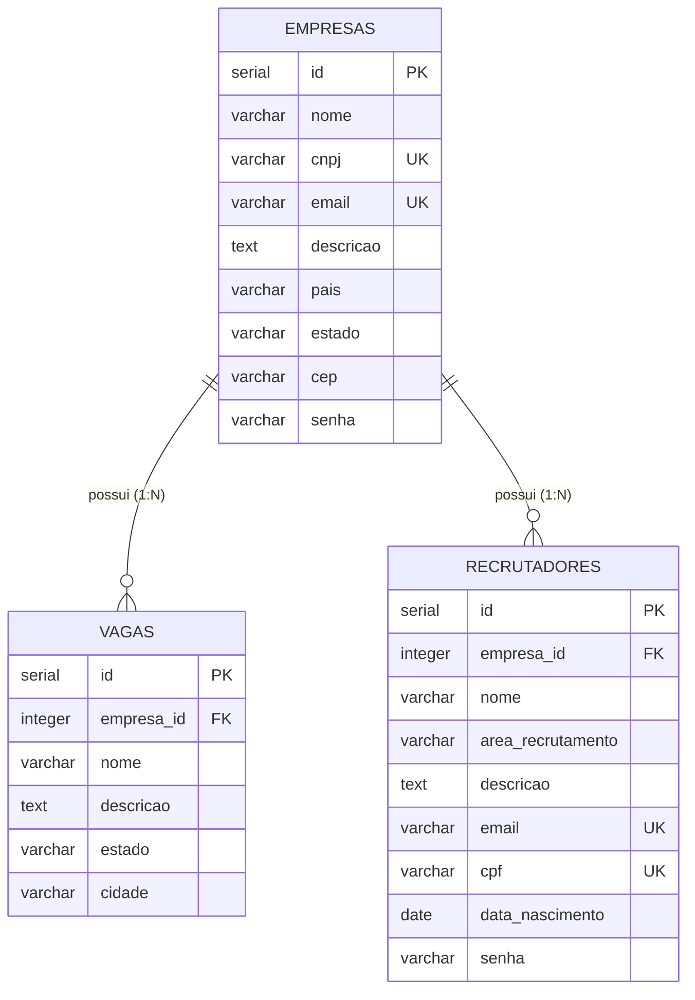

# Especificação Funcional e Técnica — Feature Recrutador

- **Feature:** `recrutador`
- **Issue vinculada:** [#1 — [FEATURE] Implementar funcionalidade Recrutador no Linketinder](https://github.com/nelsonlima1989/Linketinder-Project/issues/1)
- **Branch:** `feature/recrutador`
- **Commit base:** `98d05f1` (`docs: adiciona artefatos de preparacao SDD`)
- **Status:** Em revisão (aguardando validação com o responsável / Tutor e aprovação para commit antes de qualquer código)

---

## 1. Visão Geral e Objetivo da Feature

A funcionalidade **Recrutador** introduz no domínio do Linketinder a figura do colaborador associado a uma empresa contratante. Até o momento, o sistema representava cada `Empresa` como uma unidade monolítica sem distinção dos profissionais responsáveis pela condução dos processos seletivos.

### Objetivos principais

1. Representar a entidade **Recrutador** com os sete atributos solicitados pelo desafio: **Nome, Área de recrutamento, Descrição, E-mail, CPF, Data de nascimento e Senha**, associada a uma **Empresa** no relacionamento **Empresa (1) → (N) Recrutadores**.
2. Permitir o gerenciamento completo de recrutadores (cadastro, listagem por empresa, busca por ID, atualização e exclusão) de maneira independente no **backend (Groovy + PostgreSQL via JDBC)** e no **frontend (TypeScript + `localStorage`)**, preservando a separação arquitetural entre as camadas.
3. Disponibilizar o endpoint `POST /api/recrutadores` na API HTTP do backend (`HttpServer` do JDK), mantendo paridade com os endpoints existentes (`POST /api/candidatos`, `/api/empresas` e `/api/vagas`).
4. Permitir que o recrutador consulte as vagas pertencentes à sua própria empresa e visualize os perfis de candidatos disponíveis sob estrita observância do **Princípio do Anonimato**.
5. Proteger os dados pessoais e credenciais do recrutador (derivação de senha com **PBKDF2 + salt aleatório individual** no backend, proibição de persistir senha ou hash no `localStorage` do frontend e omissão de dados sensíveis em DTOs, respostas HTTP e logs).

---

## 2. Contexto do Domínio

O Linketinder aproxima **candidatos** e **empresas** com base na compatibilidade de **competências (skills)**, reduzindo o viés de popularidade por meio do **anonimato antes do match**.

### Estado real verificado no repositório (commit `98d05f1`)

| Domínio / Camada | Backend (Groovy 5 + PostgreSQL/JDBC) | Frontend (TypeScript + Vite + `localStorage`) |
|---|---|---|
| **Candidatos, Empresas, Vagas, Skills** | Implementados com CRUD via DAOs (`PreparedStatement`), Services, Controllers e `Menu` de terminal | Implementados com CRUD sobre `localStorage` (`candidatos`, `empresas`, `vagas`), bloqueio entre abas (`bloqueioService`) e cálculo de afinidade |
| **API HTTP** | `ApiServer.groovy` (`127.0.0.1:8080`) com `GET /api/health` e `POST /api/candidatos`, `/api/empresas`, `/api/vagas` | Não consome a API HTTP; opera 100% isolado em `localStorage` |
| **Relacionamento 1:N existente** | `Empresa (1) → (N) Vagas` (`vagas.empresa_id INTEGER NOT NULL REFERENCES empresas(id)`) | `Vaga.empresaId: number`, com exclusão em cascata ao excluir empresa (`exclusaoEmpresaService.ts`) |
| **Anonimato** | Parcial: `CandidatoAnonimo` e `EmpresaAnonima` existem, mas `EmpresaAnonima` referencia `Vaga.empresa` completa e `Menu.exibirVagasParaSelecao` exibe o nome da empresa | Parcial: `renderizarCardsCandidatos` e `renderizarCardsVagas` ocultam dados identificadores |
| **Curtidas e Matches** | Parcial: tabelas `curtidas_candidato_vaga` e `curtidas_empresa_candidato` existem no SQL sem DAO; `CurtidaService` e `MatchService` operam apenas em memória e possuem defeitos legados | Inexistente |
| **Autenticação e Autorização** | Inexistente (seleção livre de candidato/empresa por índice no `Menu`) | Inexistente (`empresaAtualId = 3` e `candidatoAtualId = 3` fixos em `main.ts`) |
| **Recrutador** | Inexistente | Inexistente |

---

## 3. Escopo Funcional

1. **Modelagem e Persistência Relacional (PostgreSQL):**
   - Criação da tabela `recrutadores` vinculada a `empresas(id)` (`1:N`), com restrições de integridade (`NOT NULL`, `UNIQUE` para `email` e `cpf`, `ON DELETE CASCADE`) e índice em `empresa_id`.
   - Inclusão de seeds de exemplo (sem senhas em texto puro) e consultas SQL em `database/queries.sql`.
2. **Backend (Groovy):**
   - Entidade `Recrutador` e DTO seguro de apresentação `RecrutadorResumo` (sem `senha`, sem `cpf`, sem `dataNascimento` e sem referência à entidade `Empresa` completa).
   - `RecrutadorRepository` e `RecrutadorDAO` (JDBC parametrizado).
   - `RecrutadorService` com validações de domínio, unicidade de CPF/e-mail, derivação criptográfica de senha (`PBKDF2WithHmacSHA256` com salt aleatório individual) e consultas de vagas da empresa e candidatos anônimos.
   - `RecrutadorController`, `RecrutadorHttpHandler` (`POST /api/recrutadores` em `ApiServer.groovy`) e integração no `Menu.groovy` / `Main.groovy`.
3. **Frontend (TypeScript):**
   - Model `Recrutador` e tipo de entrada `DadosFormularioRecrutador` em `frontend/src/models/Recrutador.ts`.
   - Seeds iniciais em `frontend/src/data/dados.ts`.
   - `recrutadorService.ts` (CRUD na chave `"recrutadores"` do `localStorage`, validações, unicidade e exclusão por empresa) e `edicaoRecrutadorService.ts` (bloqueio concorrente `"recrutador-em-edicao-{id}"`).
   - Extensão de `exclusaoEmpresaService.ts` e `empresaController.ts` para excluir em cascata os recrutadores da empresa excluída.
   - Componentes de listagem de recrutadores no perfil da empresa (`renderizarCardsRecrutadoresEmpresa.ts`), formulário de cadastro/edição (`renderizarFormularioRecrutador.ts`), controller (`recrutadorController.ts`) e navegação (`navegacaoService.ts`, `renderizarTela.ts`, `main.ts`).
4. **Testes Automatizados:**
   - Suíte Spock para DAO, Service, Controller, HttpHandler e Menu (incluindo testes de anonimato e derivação de senha).
   - Suíte Vitest para services, componentes e controllers (incluindo verificação de anonimato e ausência de senha/hash no `localStorage`).

---

## 4. Exclusões de Escopo

1. **Integração HTTP entre Frontend e Backend:** o frontend **não** fará chamadas `fetch`/`XHR` para o backend; ambas as camadas permanecem com persistências independentes.
2. **Curtidas e Matches pelo Recrutador (proposto como fora do escopo, pendente de confirmação com o Tutor):** o enunciado condiciona a ação de curtir candidatos à existência prévia da funcionalidade de curtidas. Dado o estado parcial em memória no backend e inexistente no frontend, a ação de curtir candidatos e a correção de `CurtidaService`/`MatchService` não fazem parte desta especificação.
3. **Regras de liberação de identidade pós-match:** o repositório não define quais dados são liberados após o match; nenhuma revelação pós-match será implementada nesta entrega.
4. **Autenticação, login e controle de sessão:** não será implementado sistema de login/JWT/sessão sem aprovação específica.
5. **Alteração na tabela `vagas` ou vínculo `vagas.recrutador_id`:** as vagas continuam associadas diretamente à `Empresa` (`vagas.empresa_id`).
6. **Correção de defeitos legados fora do escopo do Recrutador:** problemas pré-existentes em `CurtidaService`, `EmpresaAnonima`, `Menu.exibirVagasParaSelecao` e senhas legadas de `Candidato`/`Empresa` não serão alterados nesta feature sem tarefa própria autorizada.

---

## 5. Requisitos Funcionais Numerados

- **RF-01 — Cadastrar Recrutador (Backend e Frontend):** Permitir o cadastro de um recrutador vinculado obrigatoriamente a uma empresa existente, recebendo `empresaId`, `nome`, `areaRecrutamento`, `descricao`, `email`, `cpf`, `dataNascimento` e `senha`.
- **RF-02 — Listar Recrutadores por Empresa:** Permitir listar todos os recrutadores vinculados a uma empresa específica (`empresaId`), retornando apenas dados seguros para apresentação (sem `senha`, sem `cpf` e sem `dataNascimento` nos cards de listagem).
- **RF-03 — Buscar Recrutador por ID:** Permitir consultar um recrutador pelo seu identificador único (`id`).
- **RF-04 — Atualizar Recrutador:** Permitir atualizar os dados cadastrais de um recrutador existente (`nome`, `areaRecrutamento`, `descricao`, `email`, `cpf`, `dataNascimento` e, opcionalmente no backend, `senha`), preservando de forma imutável o seu `empresaId`.
- **RF-05 — Excluir Recrutador Individualmente:** Permitir excluir um recrutador pelo seu `id` sem excluir nem afetar a empresa à qual pertence ou as vagas da empresa.
- **RF-06 — Excluir Recrutadores em Cascata ao Excluir Empresa:** Ao excluir uma empresa, remover todos os recrutadores a ela associados (no PostgreSQL via `ON DELETE CASCADE` / service e no frontend via `excluirRecrutadoresPorEmpresa`).
- **RF-07 — Cadastrar Recrutador via API HTTP (`POST /api/recrutadores`):** Expor endpoint HTTP `POST /api/recrutadores` no `ApiServer` que valide o JSON de entrada, cadastre o recrutador no PostgreSQL e retorne `201 Created` com cabeçalho `Location: /api/recrutadores/{id}`.
- **RF-08 — Consultar Vagas da Empresa do Recrutador:** Permitir que, a partir de um recrutador, sejam listadas/analisadas exclusivamente as vagas pertencentes à sua própria empresa (`vaga.empresaId == recrutador.empresaId`).
- **RF-09 — Visualizar Perfis de Candidatos de Forma Anônima:** Permitir que o recrutador visualize os candidatos disponíveis exclusivamente por meio de representação anônima (`CandidatoAnonimo` no backend; cards anônimos no frontend).
- **RF-10 — Bloquear Edição/Exclusão Concorrente entre Abas (Frontend):** Impedir que um recrutador em edição ativa em uma aba do navegador (`recrutador-em-edicao-{id}`) seja editado ou excluído simultaneamente em outra aba.

---

## 6. Requisitos Não Funcionais

- **RNF-01 — Segurança de Credenciais:** Nenhuma senha de recrutador pode ser armazenada em texto puro ou com hash simples (como MD5, SHA-1 ou SHA-256 puro). No backend, deve ser utilizado **PBKDF2 com HMAC-SHA256 (`PBKDF2WithHmacSHA256`)**, salt criptograficamente aleatório individual (`SecureRandom`) de pelo menos 16 bytes e no mínimo 65.536 iterações (ou Argon2id/bcrypt caso uma biblioteca dedicada seja aprovada). No frontend, **nenhuma senha ou hash de senha** deve ser persistido no `localStorage`.
- **RNF-02 — Preservação do Anonimato:** Nenhuma interface, DTO de apresentação, resposta HTTP ou log pode expor dados identificadores de candidatos antes do match nem expor dados de recrutadores para candidatos.
- **RNF-03 — Prevenção de SQL Injection:** Todas as operações em `RecrutadorDAO` devem utilizar `PreparedStatement` com parâmetros vinculados (`?`) e `try-with-resources`.
- **RNF-04 — Prevenção de XSS no Frontend:** Todos os campos textuais de `Recrutador` renderizados em HTML devem ser sanitizados com `escaparHtml()`.
- **RNF-05 — Manutenibilidade e Tipagem:** No backend Groovy, utilizar tipos estáticos explícitos em declarações e assinaturas (evitando `def`). No frontend TypeScript, manter compatibilidade estrita com `tsc --noEmit` (`noUnusedLocals`, `noUnusedParameters`, `erasableSyntaxOnly`).
- **RNF-06 — Zero Dependências Externas Desnecessárias:** Implementar validações e derivação PBKDF2 utilizando a biblioteca padrão do JDK (`javax.crypto.SecretKeyFactory`, `javax.crypto.spec.PBEKeySpec`, `java.security.SecureRandom`) e APIs nativas do TypeScript/DOM no frontend.
- **RNF-07 — Testabilidade:** Todas as regras de negócio, validações, persistência simulada, handlers HTTP, componentes e restrições de anonimato devem possuir testes automatizados em Spock (backend) e Vitest (frontend).

---

## 7. Modelo de Dados do Recrutador

A entidade **Recrutador** possui modelo próprio e independente de `Pessoa`/`Informacoes` (pois não possui `sobrenome`, `cep`, `pais`, `estado` nem `whatsapp`).

### 7.1 Atributos do Domínio

| Atributo lógico | Coluna PostgreSQL (`recrutadores`) | Campo Backend (`Recrutador.groovy`) | Campo Frontend (`Recrutador.ts`) | Obrigatório? | Observações |
|---|---|---|---|---|---|
| Identificador | `id SERIAL PRIMARY KEY` | `Long id` | `id: number` | Gerado | `RETURNING id` no banco; `calcularProximoId` no frontend |
| Vínculo Empresa | `empresa_id INTEGER NOT NULL` | `Empresa empresa` | `empresaId: number` | Sim | FK para `empresas(id)`; imutável após criação |
| Nome | `nome VARCHAR(150) NOT NULL` | `String nome` | `nome: string` | Sim | Nome completo (1 a 150 chars) |
| Área de recrutamento | `area_recrutamento VARCHAR(100) NOT NULL` | `String areaRecrutamento` | `areaRecrutamento: string` | Sim | Texto livre informativo (1 a 100 chars) |
| Descrição | `descricao TEXT NOT NULL` | `String descricao` | `descricao: string` | Sim | Texto livre não vazio |
| E-mail | `email VARCHAR(150) NOT NULL UNIQUE` | `String email` | `email: string` | Sim | Formato de e-mail válido; único entre recrutadores |
| CPF | `cpf VARCHAR(11) NOT NULL UNIQUE` | `String cpf` | `cpf: string` | Sim | Exatamente 11 dígitos numéricos; único entre recrutadores |
| Data de nascimento | `data_nascimento DATE NOT NULL` | `LocalDate dataNascimento` | `dataNascimento: string` | Sim | Formato ISO `AAAA-MM-DD`; idade >= 18 anos |
| Senha | `senha VARCHAR(255) NOT NULL` | `String senha` | *(Apenas em `DadosFormularioRecrutador`; **não persistido** em `Recrutador`)* | Sim (cadastro) | Entrada >= 8 chars; armazenada como hash PBKDF2+salt no banco; nunca persistida no `localStorage` |

### 7.2 DTO de Apresentação no Backend (`RecrutadorResumo.groovy`)

Para impedir exposição acidental de `senha`, `cpf`, `dataNascimento` e da entidade `Empresa` completa (que contém `cnpj` e `senha`), a camada de apresentação utiliza:

```groovy
package com.linketinder.model

class RecrutadorResumo {
    Long id
    Long empresaId
    String nome
    String areaRecrutamento
    String descricao
    String email
}
```

---

## 8. Relacionamento Empresa 1:N Recrutadores



### Regras do relacionamento

1. **Cardinalidade:** Uma `Empresa` pode possuir `0..N` recrutadores; cada `Recrutador` pertence obrigatoriamente a `1` única `Empresa` (`empresa_id NOT NULL`).
2. **Validação na criação:** Antes de inserir um recrutador, o serviço valida `empresaId != null && empresaId > 0` e confirma que a empresa existe (`empresaRepository.buscarPorId(empresaId)` no backend; `obterEmpresaPorId(empresaId)` no frontend).
3. **Imutabilidade do vínculo:** A operação de atualização (`atualizarRecrutador` / `editarRecrutador`) não altera o `empresa_id` do recrutador.
4. **Exclusão em cascata (Empresa → Recrutadores):**
   - No PostgreSQL: `FOREIGN KEY (empresa_id) REFERENCES empresas(id) ON DELETE CASCADE`.
   - No Backend Service: `EmpresaService.excluirEmpresa` (ou `RecrutadorRepository.excluirPorEmpresa`) garante a remoção consistente.
   - No Frontend: `excluirEmpresaComVagas` (em `exclusaoEmpresaService.ts`) e `configurarExclusaoEmpresa` (em `empresaController.ts`) chamam `excluirRecrutadoresPorEmpresa(empresaId)` além de `excluirVagasPorEmpresa(empresaId)`.
5. **Exclusão isolada do Recrutador:** Excluir um recrutador remove apenas o seu registro, mantendo intactos a empresa, os demais recrutadores da empresa e todas as vagas.

---

## 9. Regras de Validação

Todas as regras abaixo devem ser aplicadas de forma equivalente no `RecrutadorService` (backend) e no `recrutadorService.ts` / formulário (frontend):

| Regra | Campo | Critério de Aceitação | Exceção / Retorno no Backend | Comportamento no Frontend |
|---|---|---|---|---|
| **VAL-01** | `empresaId` | Não nulo, inteiro `> 0` e correspondente a uma empresa existente | `IllegalArgumentException` (`400`) se nulo/`<= 0`; `NoSuchElementException` (`404`) se empresa não existir | Rejeita operação (`throw Error` / `alert`) se empresa não existir |
| **VAL-02** | `nome` | Obrigatório, `trim().length() >= 1` e `<= 150` | `IllegalArgumentException` (`400`) | Atributo HTML `required maxlength="150"` + validação de string não vazia no service |
| **VAL-03** | `areaRecrutamento` | Obrigatório, texto livre, `trim().length() >= 1` e `<= 100` | `IllegalArgumentException` (`400`) | Atributo HTML `required maxlength="100"` + validação no service |
| **VAL-04** | `descricao` | Obrigatório, texto livre, `trim().length() >= 1` | `IllegalArgumentException` (`400`) | Atributo HTML `required` + validação no service |
| **VAL-05** | `email` | Obrigatório, `<= 150` chars, formato `^[^\s@]+@[^\s@]+\.[^\s@]+$`, normalizado com `trim()` | `IllegalArgumentException` (`400`) | `type="email" required maxlength="150"` + validação por regex no service |
| **VAL-06** | `cpf` | Obrigatório, exatamente 11 dígitos numéricos (`^\d{11}$`), sem pontos ou traços | `IllegalArgumentException` (`400`) | `pattern="\d{11}" maxlength="11" required` + validação `^\d{11}$` no service |
| **VAL-07** | `cpf` / `email` (Unicidade) | Não pode existir outro recrutador com o mesmo `cpf` ou o mesmo `email` (case-insensitive para e-mail) | Exceção de conflito / argumento inválido (`409 Conflict` na API) | Rejeita cadastro/edição caso outro recrutador (`id !== atual.id`) já possua o mesmo CPF ou e-mail |
| **VAL-08** | `dataNascimento` | Obrigatória, data ISO válida (`AAAA-MM-DD`), no passado e com idade `>= 18` anos (`!dataNascimento.isAfter(LocalDate.now().minusYears(18))`) | `IllegalArgumentException` (`400`) | `type="date" required` + cálculo de idade `>= 18` anos no service |
| **VAL-09** | `senha` | Obrigatória no cadastro (e quando informada na atualização), com `trim().length() >= 8` e `length() <= 128` | `IllegalArgumentException` (`400`) | `type="password" minlength="8"` (obrigatória no cadastro; opcional na edição) + validação no service |

---

## 10. Segurança e Proteção de Dados (RN-06)

### 10.1 Proibição de Senha em Texto Puro e de SHA-256 Simples

Hashes rápidos sem salt (como MD5, SHA-1 ou SHA-256 simples) são vulneráveis a ataques de força bruta por GPU e *rainbow tables*. Portanto:

- **É proibido** armazenar senhas em texto puro ou com SHA-256 simples.
- **Algoritmo especificado para o Backend:** **PBKDF2 com HMAC-SHA256 (`PBKDF2WithHmacSHA256`)** via `javax.crypto.SecretKeyFactory` (nativo do JDK, sem dependências externas), com:
  - **Salt aleatório individual:** 16 bytes (128 bits) gerados por `java.security.SecureRandom` para cada senha.
  - **Custo (iterações):** `65536` iterações.
  - **Tamanho da chave derivada:** 256 bits (32 bytes).
  - **Formato de armazenamento na coluna `senha VARCHAR(255)`:**
    `pbkdf2_sha256$65536$<salt_base64_ou_hex>$<hash_base64_ou_hex>` (cabe confortavelmente em `VARCHAR(255)` e permite futura verificação com comparação em tempo constante via `MessageDigest.isEqual`).
  - *(Alternativa compatível caso aprovada: Argon2id ou bcrypt, desde que com salt individual por registro).*

### 10.2 Não Persistência de Senhas ou Hashes no `localStorage` (Frontend)

O `localStorage` do navegador é acessível por qualquer script executado na mesma origem e pode ser inspecionado diretamente nas ferramentas do navegador. Portanto:

- No frontend, o campo `senha` existe **apenas** no formulário (`DadosFormularioRecrutador`) para validar os requisitos mínimos de entrada (`>= 8` caracteres no cadastro).
- O serviço `recrutadorService.ts` **descarta a senha após a validação** e **nunca persiste senha nem hash de senha** no `localStorage`. O objeto `Recrutador` salvo na chave `"recrutadores"` não contém a propriedade `senha`.

### 10.3 Proteção em DTOs, Respostas HTTP e Logs

1. **Respostas HTTP:** O `POST /api/recrutadores` retorna apenas `id`, `empresaId` e `mensagem`. Nenhum endpoint ou listagem retorna `senha`.
2. **DTOs de Apresentação:** `RecrutadorResumo` não possui o campo `senha` nem `cpf` nem `dataNascimento`.
3. **Logs e Stack Traces:** Em `RecrutadorHttpHandler` e `RecrutadorDAO`, mensagens de erro e logs nunca devem interpolar o valor de `senha`, `cpf`, `email` ou `dataNascimento`.

### 10.4 Limitações Conhecidas Decorrentes da Ausência de Autenticação

Como o projeto Linketinder ainda não possui autenticação nem controle de sessão:
- A validação e o hashing da senha no cadastro preparam os registros de `Recrutador` de forma segura, mas ainda não há endpoint de login (`/api/login`) nem token de autorização protegendo as rotas ou o menu.
- Essa limitação é documentada como restrição arquitetural conhecida do MVP atual.

---

## 11. Princípio do Anonimato

> **O Princípio do Anonimato é uma restrição obrigatória e inegociável do Linketinder.**

### Critérios verificáveis de anonimato

1. **Invisibilidade da identidade do Candidato para o Recrutador antes do match:**
   - Quando o recrutador consulta candidatos no backend (`RecrutadorService.listarCandidatosAnonimosParaRecrutador` ou `CandidatoService.listarCandidatosAnonimos`), o retorno é estritamente `List<CandidatoAnonimo>`, contendo apenas `id`, `estado`, `descricaoPessoal` e `skills`.
   - No frontend, a visualização de candidatos disponível na tela da empresa/recrutador utiliza `renderizarCardsCandidatos`, exibindo apenas o código anônimo (`Candidato #1001+`), `formacao` e `skills`.
   - **Proibido exibir ou retornar:** `nome`, `sobrenome`, `cpf`, `dataNascimento`, `idade`, `cep`, `email` e `whatsapp` do candidato.
2. **Invisibilidade da identidade da Empresa e do Recrutador para o Candidato antes do match:**
   - Na visualização de vagas pelo candidato (`Menu.listarVagas` no backend; `renderizarCardsVagas` na tela do candidato no frontend), **nenhum dado do recrutador** (`nome`, `email`, `cpf`, `dataNascimento`, `areaRecrutamento`, `descricao`) pode ser incluído.
3. **Ausência de referências a entidades completas em objetos de apresentação:**
   - `RecrutadorResumo` armazena apenas `Long empresaId` (e **não** `Empresa empresa`), impedindo que a serialização ou inspeção do objeto exponha `empresa.cnpj`, `empresa.informacoes.email` ou `empresa.senha`.
4. **Proteção de dados pessoais na listagem interna de recrutadores da empresa:**
   - Mesmo na visão interna da empresa sobre seus próprios recrutadores (`Menu` e `renderizarCardsRecrutadoresEmpresa.ts`), os cards exibem apenas `id`, `nome`, `areaRecrutamento`, `descricao` e `email`, omitindo `cpf`, `dataNascimento` e `senha`.

---

## 12. Arquitetura Backend

Segue estritamente a arquitetura em camadas já adotada no repositório (`src/main/groovy/com/linketinder/`):

```text
src/main/groovy/com/linketinder/
├── model/
│   ├── Recrutador.groovy          # Entidade de domínio/persistência
│   └── RecrutadorResumo.groovy    # DTO seguro de apresentação (sem senha, sem CPF, sem Empresa completa)
├── repository/
│   └── RecrutadorRepository.groovy # Interface de persistência
├── dao/
│   └── RecrutadorDAO.groovy        # Implementação JDBC com PreparedStatement
├── service/
│   ├── SenhaHashUtil.groovy        # Utilitário PBKDF2WithHmacSHA256 + SecureRandom
│   └── RecrutadorService.groovy    # Regras RN-01..RN-09, validações, unicidade e consultas
├── controller/
│   └── RecrutadorController.groovy # Delegação para RecrutadorService
├── api/
│   ├── ApiServer.groovy            # Registro do contexto "/api/recrutadores"
│   └── RecrutadorHttpHandler.groovy # Handler HTTP POST /api/recrutadores
├── view/
│   └── Menu.groovy                 # Opções de Recrutador no terminal
└── Main.groovy                     # Injeção manual das dependências de Recrutador
```

### Contratos principais no Backend

- **`RecrutadorRepository`:**
  - `void inserir(Recrutador recrutador)`
  - `List<Recrutador> listarTodos()`
  - `List<Recrutador> listarPorEmpresaId(Long empresaId)`
  - `Recrutador buscarPorId(Long id)`
  - `Recrutador buscarPorCpf(String cpf)`
  - `Recrutador buscarPorEmail(String email)`
  - `boolean atualizar(Recrutador recrutador)`
  - `boolean excluir(Long id)`
  - `int excluirPorEmpresaId(Long empresaId)`
- **`RecrutadorService`:**
  - `void cadastrarRecrutador(Recrutador recrutador, Long empresaId)`
  - `List<RecrutadorResumo> listarRecrutadoresPorEmpresa(Long empresaId)`
  - `Recrutador buscarPorId(Long id)`
  - `boolean atualizarRecrutador(Recrutador recrutador)`
  - `boolean excluirRecrutador(Long id)`
  - `List<Vaga> listarVagasDaEmpresaDoRecrutador(Long recrutadorId)`
  - `List<CandidatoAnonimo> listarCandidatosAnonimosParaRecrutador(Long recrutadorId)`

---

## 13. Arquitetura Frontend

Segue a organização modular existente em `frontend/src/`:

```text
frontend/src/
├── models/
│   └── Recrutador.ts                                    # Interfaces Recrutador e DadosFormularioRecrutador
├── data/
│   └── dados.ts                                         # Adição do array inicial `recrutadores: Recrutador[]`
├── services/
│   ├── recrutador/
│   │   ├── recrutadorService.ts                         # CRUD em localStorage ("recrutadores") + validações
│   │   └── edicaoRecrutadorService.ts                   # Bloqueio entre abas ("recrutador-em-edicao")
│   ├── empresa/
│   │   └── exclusaoEmpresaService.ts                    # Cascata: vagas + recrutadores da empresa
│   └── utils/
│       └── navegacaoService.ts                          # Inclusão da tela "cadastro-recrutador"
├── components/
│   ├── recrutadores/
│   │   ├── renderizarCardsRecrutadoresEmpresa.ts        # Cards de recrutadores no perfil da empresa
│   │   └── renderizarFormularioRecrutador.ts            # Formulário de criação/edição de recrutador
│   ├── empresas/
│   │   └── renderizarPerfilEmpresa.ts                   # Seção "Meus recrutadores" + botão "#botao-novo-recrutador"
│   └── layout/
│       └── renderizarTela.ts                            # Renderizador para "cadastro-recrutador"
├── controllers/
│   ├── recrutadorController.ts                          # Eventos de criação, edição, exclusão e formulário
│   └── empresaController.ts                             # Acionamento de excluirRecrutadoresPorEmpresa na exclusão da empresa
└── main.ts                                              # Wiring dos eventos de recrutador na tela "empresa" e "cadastro-recrutador"
```

---

## 14. Persistência PostgreSQL e `localStorage`

### 14.1 PostgreSQL (`database/database.sql` e `database/queries.sql`)

**DDL (`database/database.sql`):**
```sql
-- TABELA: recrutadores
-- Relação 1:N entre empresas e recrutadores

CREATE TABLE recrutadores
(
    id                SERIAL PRIMARY KEY,
    empresa_id        INTEGER      NOT NULL,
    nome              VARCHAR(150) NOT NULL,
    area_recrutamento VARCHAR(100) NOT NULL,
    descricao         TEXT         NOT NULL,
    email             VARCHAR(150) NOT NULL UNIQUE,
    cpf               VARCHAR(11)  NOT NULL UNIQUE,
    data_nascimento   DATE         NOT NULL,
    senha             VARCHAR(255) NOT NULL,

    CONSTRAINT fk_recrutadores_empresa
        FOREIGN KEY (empresa_id)
            REFERENCES empresas (id)
            ON DELETE CASCADE
);

CREATE INDEX idx_recrutadores_empresa_id
    ON recrutadores (empresa_id);
```

**Seeds e Consultas (`database/queries.sql`):**
- Inserção de recrutadores fictícios associados às empresas existentes (`empresa_id` 1 a 5), incluindo empresa com mais de um recrutador para demonstrar a relação `1:N`, utilizando valores de `senha` já no formato `pbkdf2_sha256$65536$...` (sem senhas em texto puro).
- Consulta `SELECT` juntando `recrutadores` e `empresas` (`INNER JOIN`) omitindo a coluna `senha`.

### 14.2 `localStorage` (Frontend)

- **Chave de armazenamento:** `"recrutadores"` (gerenciada por `salvarDados` e `carregarDados` de `storage.ts`).
- **Chave de bloqueio de edição entre abas:** `"recrutador-em-edicao-{id}"` (gerenciada por `criarServicoBloqueio` de `bloqueioService.ts`).
- **Formato persistido:** array JSON de objetos `Recrutador` (`id`, `empresaId`, `nome`, `areaRecrutamento`, `descricao`, `email`, `cpf`, `dataNascimento`), **sem campo `senha`**.

---

## 15. Contrato Preliminar da API HTTP

### Endpoint: `POST /api/recrutadores`

- **Host / Porta:** `http://127.0.0.1:8080/api/recrutadores`
- **Headers obrigatórios da requisição:** `Content-Type: application/json` (aceita parâmetro `; charset=UTF-8`)
- **Tamanho máximo do corpo:** `16384` bytes (16 KiB)

**Corpo da Requisição (JSON):**
```json
{
  "empresaId": 1,
  "nome": "Fernanda Lima",
  "areaRecrutamento": "Engenharia de Software",
  "descricao": "Recrutadora técnica focada em vagas backend Java e Groovy",
  "email": "fernanda.lima@pastelsoft.com",
  "cpf": "12345678909",
  "dataNascimento": "1994-05-20",
  "senha": "SenhaForte@2026"
}
```

**Respostas HTTP:**

| Código HTTP | Condição | Headers de Resposta | Corpo de Resposta (JSON) |
|---|---|---|---|
| `201 Created` | Cadastro realizado com sucesso | `Content-Type: application/json; charset=UTF-8`, `Location: /api/recrutadores/{id}` | `{"id": 1, "empresaId": 1, "mensagem": "Recrutador cadastrado com sucesso."}` |
| `400 Bad Request` | JSON malformado, campos obrigatórios ausentes/vazios, `empresaId` não inteiro positivo, CPF inválido (`!= 11` dígitos), e-mail inválido, data inválida ou idade `< 18` anos, senha `< 8` chars | `Content-Type: application/json; charset=UTF-8` | `{"erro": "<mensagem descritiva>"}` (ou `{"erro": "Campos obrigatórios inválidos.", "campos": [...]}`) |
| `404 Not Found` | Subcaminho inexistente ou `empresaId` não corresponde a empresa cadastrada | `Content-Type: application/json; charset=UTF-8` | `{"erro": "Empresa não encontrada."}` |
| `405 Method Not Allowed` | Método HTTP diferente de `POST` | `Allow: POST`, `Content-Type: application/json; charset=UTF-8` | `{"erro": "Método não permitido."}` |
| `409 Conflict` | `cpf` ou `email` já cadastrado para outro recrutador | `Content-Type: application/json; charset=UTF-8` | `{"erro": "CPF ou e-mail já cadastrado para outro recrutador."}` |
| `413 Content Too Large` | Corpo da requisição superior a 16 KiB | `Content-Type: application/json; charset=UTF-8` | `{"erro": "Corpo da requisição muito grande."}` |
| `415 Unsupported Media Type` | `Content-Type` ausente ou diferente de `application/json` | `Content-Type: application/json; charset=UTF-8` | `{"erro": "Content-Type deve ser application/json."}` |
| `500 Internal Server Error` | Falha inesperada de persistência (`IllegalStateException`) | `Content-Type: application/json; charset=UTF-8` | `{"erro": "Não foi possível cadastrar o recrutador."}` |

---

## 16. Fluxos de Cadastro, Consulta, Atualização e Exclusão

### 16.1 Fluxo de Cadastro
1. Usuário/cliente fornece os dados do recrutador e o `empresaId`.
2. Camada de serviço valida `empresaId > 0`, existência da empresa e regras `VAL-02` a `VAL-09` (incluindo unicidade de CPF e e-mail e idade >= 18 anos).
3. No backend, `SenhaHashUtil.gerarHash(senha)` gera o hash `PBKDF2WithHmacSHA256` com salt aleatório individual, substituindo a senha no objeto `Recrutador` antes de `recrutadorDAO.inserir(recrutador)`.
4. No frontend, `criarRecrutador` valida a senha, descarta-a e persiste o novo `Recrutador` (com `id = calcularProximoId`) na chave `"recrutadores"` do `localStorage`.

### 16.2 Fluxo de Consulta (Listagem por Empresa e Análise de Vagas/Candidatos)
1. **Listar recrutadores da empresa:** consulta todos os recrutadores com `empresaId` igual ao da empresa selecionada e retorna `RecrutadorResumo` (backend) ou renderiza `renderizarCardsRecrutadoresEmpresa` (frontend, exibindo nome, área, descrição e e-mail).
2. **Analisar vagas e candidatos (visão do recrutador):**
   - Recupera o recrutador por ID.
   - Filtra as vagas pertencentes exclusivamente a `recrutador.empresaId`.
   - Recupera os candidatos disponíveis exclusivamente no formato anônimo (`CandidatoAnonimo` no backend; `renderizarCardsCandidatos` no frontend).

### 16.3 Fluxo de Atualização
1. No frontend, ao clicar em "Editar" no card do recrutador, verifica `recrutadorEstaBloqueado(id)`. Se livre, ativa `bloquearRecrutador(id)` e abre `renderizarFormularioRecrutador(recrutador)`.
2. Ao submeter a edição, valida os campos (`VAL-02` a `VAL-08`, verificando unicidade de CPF/e-mail apenas contra outros recrutadores `r.id != id`). Se uma nova senha for preenchida, valida `VAL-09`.
3. Atualiza o registro mantendo o `empresaId` original inalterado e libera o bloqueio `recrutador-em-edicao-{id}`.

### 16.4 Fluxo de Exclusão (Individual e Cascata)
1. **Individual:** Verifica se o recrutador existe (e, no frontend, se não está bloqueado em outra aba). Remove apenas o recrutador selecionado.
2. **Em cascata (ao excluir Empresa):** Quando a empresa é excluída, todos os recrutadores vinculados ao `empresaId` são removidos junto com as vagas da empresa.

---

## 17. Cenários de Aceite (Formato Dado / Quando / Então)

- **CA-01 — Cadastro válido de recrutador (RF-01, RN-01, RN-03, RN-05):**
  - **Dado** que existe uma empresa cadastrada com `id = 1`,
  - **Quando** um recrutador é cadastrado para `empresaId = 1` com nome válido, área de recrutamento, descrição, e-mail único, CPF de 11 dígitos único, data de nascimento com idade >= 18 anos e senha com >= 8 caracteres,
  - **Então** o recrutador é persistido com sucesso, recebe um `id` único e fica associado à empresa `1`.

- **CA-02 — Relacionamento 1:N: múltiplos recrutadores na mesma empresa (RF-01, RF-02, RN-01):**
  - **Dado** que a empresa `id = 1` já possui um recrutador cadastrado,
  - **Quando** um segundo recrutador com CPF e e-mail distintos é cadastrado para a mesma empresa `id = 1`,
  - **Então** ambos os recrutadores são persistidos e retornados na listagem de recrutadores da empresa `1`.

- **CA-03 — Tentativa de cadastro para empresa inexistente ou inválida (RF-01, RF-07, RN-01, VAL-01):**
  - **Dado** que não existe empresa com `id = 999` (ou o `empresaId` informado é `<= 0` ou nulo),
  - **Quando** se tenta cadastrar um recrutador para essa empresa,
  - **Então** a operação é rejeitada (`NoSuchElementException` / HTTP `404` para empresa inexistente; `IllegalArgumentException` / HTTP `400` para `empresaId <= 0`), e nenhum recrutador é persistido.

- **CA-04 — Rejeição de CPF duplicado ou e-mail duplicado entre recrutadores (RF-01, RF-04, RN-04, VAL-07):**
  - **Dado** que já existe um recrutador cadastrado com `cpf = "12345678901"` e `email = "ana@empresa.com"`,
  - **Quando** se tenta cadastrar outro recrutador (ou atualizar outro recrutador existente) utilizando o mesmo CPF ou o mesmo e-mail,
  - **Então** a operação é rejeitada com erro de duplicidade (HTTP `409 Conflict` na API) e o segundo registro não é gravado.

- **CA-05 — Rejeição de CPF com formato inválido e e-mail malformado (RF-01, RN-05, VAL-05, VAL-06):**
  - **Dado** um payload de cadastro de recrutador com CPF contendo pontuação (`"123.456.789-01"`), letras ou quantidade de dígitos diferente de 11, ou e-mail sem formato válido,
  - **Quando** o cadastro é submetido no backend ou no frontend,
  - **Então** a validação falha com erro `400` / mensagem de validação antes da persistência.

- **CA-06 — Validação de data de nascimento e idade mínima de 18 anos (RF-01, RN-05, VAL-08):**
  - **Dado** um cadastro de recrutador cuja `dataNascimento` esteja no futuro ou corresponda a uma idade inferior a 18 anos na data atual,
  - **Quando** o cadastro ou atualização é submetido,
  - **Então** a operação é rejeitada com erro de validação informando a exigência de idade mínima de 18 anos.

- **CA-07 — Validação de senha e armazenamento seguro com PBKDF2 + salt no Backend (RF-01, RNF-01, RN-06, VAL-09):**
  - **Dado** um cadastro de recrutador no backend com senha válida (`>= 8` caracteres),
  - **Quando** o `RecrutadorService` processa o cadastro,
  - **Então** senhas com menos de 8 caracteres são rejeitadas, e para senhas válidas o valor enviado ao `RecrutadorDAO` contém o prefixo `pbkdf2_sha256$`, um salt aleatório individual e o hash derivado (nunca a senha em texto puro nem um SHA-256 simples).

- **CA-08 — Não persistência de senha ou hash no `localStorage` do Frontend (RF-01, RNF-01, RN-06):**
  - **Dado** o cadastro ou edição de um recrutador no formulário do frontend informando uma senha válida,
  - **Quando** o registro é salvo na chave `"recrutadores"` do `localStorage`,
  - **Então** o JSON armazenado no `localStorage` **não contém** a chave `"senha"` nem o texto/hash da senha informada.

- **CA-09 — Atualização de recrutador preservando vínculo com a empresa e bloqueio entre abas (RF-04, RF-10, RN-02, RN-07):**
  - **Dado** um recrutador existente pertencente à empresa `id = 3`,
  - **Quando** seus dados são editados,
  - **Então** os novos dados são persistidos mantendo `empresaId = 3`, e enquanto o bloqueio `recrutador-em-edicao-{id}` estiver ativo em outra aba, qualquer tentativa concorrente de edição ou exclusão é impedida.

- **CA-10 — Exclusão individual de recrutador (RF-05, RN-02):**
  - **Dado** um recrutador cadastrado para uma empresa que possui vagas e outros recrutadores,
  - **Quando** esse recrutador é excluído pelo seu `id`,
  - **Então** apenas esse recrutador é removido, permanecendo intactos a empresa, suas vagas e os demais recrutadores.

- **CA-11 — Exclusão em cascata ao excluir Empresa (RF-06, RN-02):**
  - **Dado** uma empresa que possui vagas e recrutadores vinculados,
  - **Quando** a empresa é excluída,
  - **Então** todos os recrutadores vinculados àquela empresa são excluídos em cascata juntamente com as vagas da empresa.

- **CA-12 — Consulta de vagas restrita à própria empresa do recrutador (RF-08, RN-08):**
  - **Dado** que existem vagas da empresa `1` e vagas da empresa `2`, e um recrutador pertencente à empresa `1`,
  - **Quando** o recrutador consulta as vagas para análise,
  - **Então** apenas as vagas da empresa `1` são retornadas, mesmo que sua `areaRecrutamento` tenha qualquer descrição textual.

- **CA-13 — Preservação do anonimato dos candidatos para o recrutador (RF-09, RNF-02, RN-09):**
  - **Dado** que existem candidatos cadastrados com nome, CPF, data de nascimento, CEP, e-mail e WhatsApp,
  - **Quando** o recrutador consulta a lista de candidatos disponíveis,
  - **Então** apenas dados anônimos (`id`/código, `estado`, `descricaoPessoal`/`formacao` e `skills`) são retornados ou renderizados, sem nenhuma exposição de nome, CPF, e-mail, CEP, WhatsApp ou idade/data de nascimento.

- **CA-14 — Proteção dos dados do recrutador e da empresa perante o candidato (RNF-02, RN-09):**
  - **Dado** que uma empresa possui recrutadores e vagas cadastradas,
  - **Quando** um candidato consulta as vagas disponíveis ou quando DTOs/respostas HTTP de recrutador são gerados,
  - **Então** nenhum dado do recrutador aparece para o candidato, e nenhuma resposta HTTP, DTO (`RecrutadorResumo`) ou card de listagem expõe `senha`, `cpf` ou `dataNascimento` do recrutador.

- **CA-15 — Independência Frontend/Backend e ausência de regressão (RNF-05, RNF-07, RN-12, RN-13):**
  - **Dado** o conjunto completo de funcionalidades existentes (Candidatos, Empresas, Vagas, Afinidade, Gráfico de Skills, API HTTP),
  - **Quando** a suíte completa de testes Spock (`./gradlew test`) e Vitest (`npm test` + `npx tsc --noEmit`) é executada,
  - **Então** todos os testes existentes e novos passam sem regressões e sem chamadas HTTP entre frontend e backend.

---

## 18. Estratégia de Testes Spock e Vitest

### 18.1 Backend — Spock (`src/test/groovy/`)

Todos os testes backend utilizam mocks Spock (`Mock(ConexaoProvider)`, `Mock(Connection)`, `Mock(PreparedStatement)`, `Mock(ResultSet)`, `Mock(RecrutadorRepository)`), sem depender de instância ativa do PostgreSQL:

1. **`daoTest/RecrutadorDAOSpec.groovy`:**
   - Verifica SQL parametrizado e mapeamento em `inserir`, `listarTodos`, `listarPorEmpresaId`, `buscarPorId`, `buscarPorCpf`, `buscarPorEmail`, `atualizar`, `excluir` e `excluirPorEmpresaId`, além do tratamento de `SQLException` → `IllegalStateException`.
2. **`serviceTest/RecrutadorServiceSpec.groovy`:**
   - Testa todos os casos de sucesso e falha de `VAL-01` a `VAL-09` (empresa nula/inválida/inexistente, CPF inválido/duplicado, e-mail inválido/duplicado, menor de 18 anos, senha curta).
   - Verifica que `SenhaHashUtil` gera hashes `pbkdf2_sha256$` únicos com salts distintos para a mesma senha e nunca persiste texto puro.
   - Testa o relacionamento `1:N` (múltiplos recrutadores por empresa).
   - **Testes de anonimato:** verifica que `listarRecrutadoresPorEmpresa` retorna `RecrutadorResumo` sem `senha`, `cpf` ou objeto `Empresa`, e que `listarCandidatosAnonimosParaRecrutador` retorna apenas `CandidatoAnonimo`.
3. **`controllerTest/RecrutadorControllerSpec.groovy`:**
   - Verifica delegação de chamadas para `RecrutadorService`.
4. **`apiTest/RecrutadorHttpHandlerSpec.groovy`:**
   - Servidor HTTP efêmero (`HttpServer.create(new InetSocketAddress("127.0.0.1", 0), 0)`) testando respostas reais `201`, `400`, `404`, `405`, `409`, `413`, `415`, `500`, header `Location` e ausência de `senha`/`cpf` no corpo JSON.
5. **`uiTest/MenuSpec.groovy`:**
   - Cenários adicionais para as opções de recrutador no menu de terminal.

### 18.2 Frontend — Vitest (`frontend/src/`)

1. **`services/recrutador/recrutadorService.test.ts`:**
   - CRUD completo em `localStorage`, relacionamento `1:N`, validações `VAL-01` a `VAL-09`, unicidade de CPF/e-mail, exclusão por empresa e **verificação explícita de que o JSON salvo no `localStorage` não contém `"senha"`**.
2. **`services/recrutador/edicaoRecrutadorService.test.ts`:**
   - Bloqueio de edição concorrente, expiração e liberação (`recrutador-em-edicao-{id}`).
3. **`services/empresa/exclusaoEmpresaService.test.ts`:**
   - Verifica que excluir uma empresa remove suas vagas **e** seus recrutadores em cascata.
4. **`components/recrutadores/renderizarCardsRecrutadoresEmpresa.test.ts` e `renderizarFormularioRecrutador.test.ts`:**
   - Renderização dos cards e do formulário, escape contra XSS (`escaparHtml`) e **teste de anonimato/privacidade** garantindo que `cpf`, `dataNascimento` e `senha` não aparecem nos cards de listagem e que dados de recrutador não aparecem em `renderizarCardsVagas`.
5. **`controllers/recrutadorController.test.ts`, `services/utils/navegacaoService.test.ts` e `components/layout/renderizarTela.test.ts`:**
   - Fluxos de UI, submissão de formulário, bloqueio entre abas e navegação.

---

## 19. Riscos Técnicos e Dependências

| ID | Risco / Dependência | Severidade | Mitigação Especificada |
|---|---|---|---|
| **RT-01** | Exposição de senha em texto puro ou hash fraco (SHA-256 simples) | Crítica | Uso de `PBKDF2WithHmacSHA256` com salt aleatório de 16 bytes e 65.536 iterações no backend; não persistência de senha/hash no `localStorage` do frontend. |
| **RT-02** | Quebra indireta do anonimato da empresa ou do candidato | Crítica | Proibição de exibir dados de recrutador nas vagas vistas pelo candidato; uso exclusivo de `CandidatoAnonimo` / `renderizarCardsCandidatos` para o recrutador; uso de `RecrutadorResumo` sem referência a `Empresa`. |
| **RT-03** | Divergência de integridade referencial na exclusão de empresa | Alta | `ON DELETE CASCADE` na FK `fk_recrutadores_empresa` no PostgreSQL e chamada a `excluirRecrutadoresPorEmpresa` em `exclusaoEmpresaService.ts` / `empresaController.ts`. |
| **RT-04** | Estado parcial e defeituoso de Curtidas e Matches no código legado | Média | Exclusão de curtidas/matches do escopo de implementação do Recrutador (condicionada à validação do Tutor), evitando acoplamento com código em memória defeituoso. |
| **RT-05** | Ausência de autenticação real no sistema | Média | Documentar como limitação estrutural do MVP; validar rigorosamente a senha no cadastro e armazená-la derivada com PBKDF2 no backend. |

---

## 20. Decisões Aprovadas e Pendentes

### 20.1 Decisões Aprovadas pelo Responsável pelo Projeto (Etapa 04)

- **RN-01:** Vínculo único e obrigatório do Recrutador com uma Empresa existente (`empresa_id NOT NULL`, cardinalidade `1:N`).
- **RN-02:** Vínculo `empresa_id` imutável após o cadastro; exclusão em cascata dos recrutadores quando a empresa é excluída; exclusão individual do recrutador sem afetar a empresa.
- **RN-03:** Modelo `Recrutador` próprio e independente de `Pessoa`/`Informacoes`, com campo único `nome` e os 7 atributos do enunciado + vínculo com `Empresa`.
- **RN-04:** Unicidade de `cpf` e `email` verificada no escopo de recrutadores (banco e frontend).
- **RN-05:** Validações obrigatórias: `cpf` com 11 dígitos numéricos (`^\d{11}$`), `email` válido, `dataNascimento` no passado com idade mínima de 18 anos, `areaRecrutamento` como texto livre informativo (até 100 caracteres).
- **RN-06 (com correção de segurança da Etapa 05):** Senha com mínimo de 8 caracteres; derivação no backend com **PBKDF2 + salt aleatório individual** (`PBKDF2WithHmacSHA256`), nunca retornada em DTOs/API/logs; validada no formulário do frontend e **não persistida (nem em texto puro nem em hash) no `localStorage`**.
- **RN-07:** CRUD completo no backend e no frontend (com bloqueio entre abas `recrutador-em-edicao-{id}`), endpoint `POST /api/recrutadores` e opções no `Menu`.
- **RN-08:** O recrutador analisa todas as vagas da sua própria empresa (`empresaId`) e visualiza candidatos de forma anônima, sem coluna `recrutador_id` em `vagas`.
- **RN-09:** Anonimato bilateral estrito antes do match (recrutador só vê candidatos anônimos; candidato não vê dados de recrutador; cards não expõem senha/CPF/nascimento).
- **RN-10:** Ausência de liberação de dados pós-match nesta entrega.
- **RN-11:** Curtidas e matches propostos como fora do escopo desta entrega (sujeito à confirmação do Tutor — ver seção 21).
- **RN-12:** DDL em `database/database.sql`, seeds/consultas em `database/queries.sql`, endpoint `POST /api/recrutadores` no backend e manutenção da independência entre frontend e backend.
- **RN-13:** Suíte completa de testes automatizados em Spock e Vitest, incluindo testes explícitos de anonimato e segurança de credenciais.

### 20.2 Decisões Pendentes de Confirmação Externa (Tutor)

Embora aprovadas tecnicamente pelo responsável pelo repositório na Etapa 04, as decisões de contorno de escopo listadas na **Seção 21** permanecem registradas como pendentes de validação com o Tutor caso haja requisito pedagógico adicional na avaliação da trilha.

---

## 21. Perguntas que Exigem Validação com o Tutor

1. **Escopo de Curtidas e Matches (RN-11):** Confirma-se que a ação de "recrutador curtir candidato" permanece fora do escopo obrigatório desta entrega, visto que a funcionalidade de curtidas ainda não está persistida em DAO/PostgreSQL nem implementada no frontend?
2. **Regras Pós-Match (RN-10):** Confirma-se que não há necessidade de implementar tela ou endpoint de liberação de identidade pós-match nesta entrega?
3. **Escopo de Acesso às Vagas da Empresa (RN-08):** Confirma-se que o recrutador visualiza/analisa todas as vagas pertencentes à sua empresa (`empresaId`), sendo o atributo `areaRecrutamento` um metadado informativo de especialidade, sem criar chave estrangeira `recrutador_id` na tabela `vagas`?
4. **Proteção de Senha no Frontend Isolado (RN-06):** Confirma-se a diretriz de segurança de validar a senha no formulário de cadastro do frontend mas não persistir senha nem hash no `localStorage`?

---

## 22. Matriz de Rastreabilidade (RN-01 a RN-13)

| Regra de Negócio | Descrição Resumida | Requisitos Funcionais / Não Funcionais | Critérios de Aceite | Testes Previstos (Spock / Vitest) |
|---|---|---|---|---|
| **RN-01** | Vínculo obrigatório `Empresa (1) → (N) Recrutadores` (`empresa_id NOT NULL`) | RF-01, RF-02, RF-07 | CA-01, CA-02, CA-03 | `RecrutadorServiceSpec`, `RecrutadorDAOSpec`, `RecrutadorHttpHandlerSpec`, `recrutadorService.test.ts` |
| **RN-02** | Imutabilidade do vínculo `empresa_id` e exclusão em cascata ao excluir empresa | RF-04, RF-05, RF-06 | CA-09, CA-10, CA-11 | `RecrutadorServiceSpec`, `RecrutadorDAOSpec`, `exclusaoEmpresaService.test.ts`, `recrutadorService.test.ts` |
| **RN-03** | Modelo `Recrutador` independente com os 7 atributos do enunciado + `empresaId` | RF-01, RF-03, RF-04 | CA-01, CA-09 | `RecrutadorDAOSpec`, `RecrutadorServiceSpec`, `recrutadorService.test.ts`, `renderizarFormularioRecrutador.test.ts` |
| **RN-04** | Unicidade de `cpf` e `email` entre recrutadores | RF-01, RF-04, RF-07 | CA-04 | `RecrutadorServiceSpec`, `RecrutadorHttpHandlerSpec`, `recrutadorService.test.ts` |
| **RN-05** | Validações de formato (`cpf` 11 dígitos, `email` válido, idade `>= 18` anos, textos obrigatórios) | RF-01, RF-04, RF-07 | CA-01, CA-05, CA-06 | `RecrutadorServiceSpec`, `RecrutadorHttpHandlerSpec`, `recrutadorService.test.ts`, `recrutadorController.test.ts` |
| **RN-06** | Senha `>= 8` chars; PBKDF2 + salt aleatório individual no backend; sem senha/hash no `localStorage`; oculta em DTOs/API/logs | RF-01, RF-07, RNF-01 | CA-07, CA-08, CA-14 | `RecrutadorServiceSpec`, `RecrutadorHttpHandlerSpec`, `recrutadorService.test.ts`, `renderizarCardsRecrutadoresEmpresa.test.ts` |
| **RN-07** | Operações CRUD completas, `POST /api/recrutadores`, `Menu` e bloqueio entre abas no frontend | RF-01 a RF-07, RF-10 | CA-01, CA-09, CA-10 | `RecrutadorDAOSpec`, `RecrutadorControllerSpec`, `RecrutadorHttpHandlerSpec`, `MenuSpec`, `edicaoRecrutadorService.test.ts`, `recrutadorController.test.ts` |
| **RN-08** | Recrutador analisa todas as vagas da própria empresa (`empresaId`) e candidatos anônimos | RF-08, RF-09 | CA-12, CA-13 | `RecrutadorServiceSpec`, `MenuSpec`, `recrutadorService.test.ts` |
| **RN-09** | Anonimato bilateral antes do match (`CandidatoAnonimo`, `RecrutadorResumo`, ocultação perante candidato) | RF-02, RF-09, RNF-02 | CA-13, CA-14 | `RecrutadorServiceSpec`, `MenuSpec`, `renderizarCardsRecrutadoresEmpresa.test.ts`, `renderizarCardsVagas.test.ts`, `renderizarCardsCandidatos.test.ts` |
| **RN-10** | Não implementação de liberação de identidade pós-match nesta entrega | Exclusão 4.3, RNF-02 | CA-13, CA-14 | Verificação de escopo e testes de anonimato |
| **RN-11** | Curtidas e matches fora do escopo desta entrega | Exclusão 4.2 | CA-15 | Verificação de não regressão das suítes existentes |
| **RN-12** | Independência frontend/backend, DDL em `database.sql`, seeds em `queries.sql` e `POST /api/recrutadores` | RF-07, RNF-03, RNF-05 | CA-01, CA-03, CA-04, CA-15 | `RecrutadorDAOSpec`, `RecrutadorHttpHandlerSpec`, `recrutadorService.test.ts` |
| **RN-13** | Cobertura de testes automatizados (Spock + Vitest) e testes de anonimato/segurança | RNF-01, RNF-02, RNF-07 | CA-01 a CA-15 | Todas as specs Spock e arquivos `*.test.ts` do Vitest |
